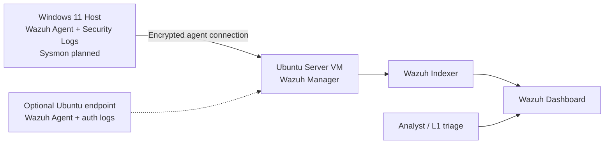

# Lab architecture

## Resource plan
For a small all-in-one deployment, follow the current Wazuh quickstart sizing guidance. A practical starting allocation on a 16 GB host is 4 vCPU, 8 GB RAM and 50 GB virtual disk for the server VM, while leaving the Windows host available as the endpoint. If the host becomes unstable, stop the VM or reduce the lab scope rather than overcommitting memory.

## Data flow
1. Endpoint agent collects configured logs and telemetry.
2. Wazuh Manager decodes and evaluates events against rules.
3. Alerts are indexed and displayed in the dashboard.
4. Analyst validates context, records evidence and decides whether to close or escalate.
